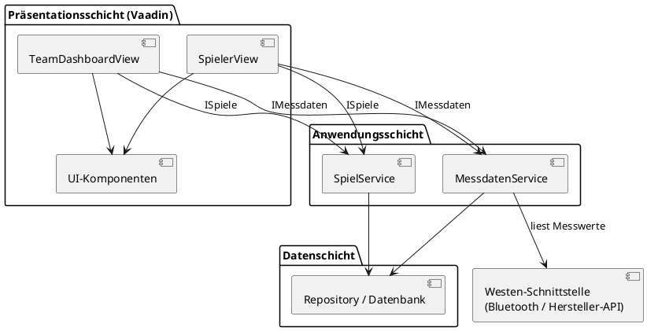

# TeamApp – Figma-Skizzen in Vaadin umgesetzt

Grundgerüst für die Abschlusspräsentation (SE, 3. Semester): beide Figma-Frames
(**Team Dashboard** und **Spieler**) als lauffähige Vaadin-Oberfläche, mit Schichtenarchitektur.

## 1. Was laut Folien in die Abschlusspräsentation gehört

| Quelle | Gefordert |
|---|---|
| Block 1, Projekt in Gruppen | Präsentation: Einführung, **UML**, **Figma**, **erster Prototyp**, Beantwortung von Fragen |
| Block 5, Aufgabe Architektur | Geeignete Softwarearchitektur wählen **und begründen** |
| Block 5, Aufgabe Komponentendiagramm | Wesentliche **Komponenten + Verantwortlichkeiten**, wie sie **kommunizieren**, als **UML-Komponentendiagramm**, Entscheidungen begründen |
| Block 6, UI/UX | UI-Skizze (Papier) → **Figma-Design** → **UI mit Vaadin**, dabei die **10 Usability-Heuristiken von Nielsen** berücksichtigen |

"Komponenten" meint also zwei Dinge: die **Architektur-Komponenten** im UML-Diagramm
und die **UI-Komponenten** in Vaadin. Dieses Projekt ist so gebaut, dass beides zusammenpasst.

## 2. Starten

Voraussetzung: **Java 21** (z.B. Temurin) und IntelliJ IDEA (Community reicht) mit Vaadin-Plugin.

1. Ordner in IntelliJ öffnen (als Maven-Projekt).
2. `de.teamapp.Application` starten (grüner Pfeil).
3. Browser: <http://localhost:8080> (Dashboard), <http://localhost:8080/spieler> und <http://localhost:8080/training>.
   Tipp: Browser-DevTools → Handy-Ansicht, die App ist auf ~400px Breite ausgelegt.

Oder im Terminal: `mvnw spring-boot:run` (Windows: `mvnw.cmd spring-boot:run`). Beim ersten Start lädt Vaadin einmalig Frontend-Pakete, das dauert 1–2 Minuten.

> Wichtig: **Vaadin 25** verwenden (wie auf start.vaadin.com). Vaadin 24 braucht inzwischen eine
> kostenpflichtige Lizenz. Vaadin 25 braucht Java 21 und Spring Boot 4 (steht auch auf Folie Block 6).

Wenn ihr schon ein Projekt von start.vaadin.com habt: einfach die Ordner `domain`, `service`, `ui`
und die Datei `styles.css` hineinkopieren und die `package`-Zeilen anpassen.

## 3. Architektur (Schichtenarchitektur, passend zu Block 5)

```
src/main/java/de/teamapp/
├── Application.java              Start + globale Styles
├── ui/                           GUI-SCHICHT (Vaadin Flow)
│   ├── layout/MainLayout         Titel oben, Navigation unten
│   ├── views/
│   │   ├── TeamDashboardView       Route "/"          (Figma Frame 1)
│   │   ├── SpielerView             Route "/spieler"   (Figma Frame 2)
│   │   └── TrainingView            Route "/training"  (KI-Vorschlag, FR-16..20)
│   └── components/               Card, StatCard, RueckmeldungSummary, DistanzBalken
│
│   DOMÄNENSCHICHT – ein Paket pro Komponente aus dem Schichtenmodell:
├── spiele/        "Spiele & Team"          SpielService, Spiel, Spieler, Rueckmeldung
├── messdaten/     "Messdaten"              MessdatenService, Messung
├── datenschutz/   "Datenschutz"            PseudonymisierungService (NFR-04)
└── training/      "KI-Trainingsvorschlag"  TrainingsvorschlagService, Uebung, ...
    ├── KiClient                 Interface zum KI-Dienst (austauschbar, NFR-06)
    └── RegelbasierterKiClient   Platzhalter, bis ein echtes EU-Sprachmodell angebunden ist
```

Noch offen (siehe Schichtenmodell): `konto/` (Spring Security), Maildienst, Trackeranbindung, Datenbank.

Regel: **Views reden nur mit Services, nie direkt mit Daten.** Die KI bekommt nur pseudonymisierte Daten. Spring gibt die Services
per Konstruktor in die View (Dependency Injection). Später kommt darunter eine
Datenzugriffsschicht (Spring Data JPA + Datenbank) und eine Schnittstelle zur Weste.

**Begründung für die Präsentation:**
- Trennung von Verantwortlichkeiten und hohe Kohäsion: UI, Logik und Daten liegen in eigenen Schichten.
- Lose Kopplung: Die UI kennt nur die Service-Methoden. Ob die Daten aus einer Datenbank oder
  per Bluetooth von der Weste kommen, ist der UI egal.
- Vermeidung von Redundanz: z.B. `RueckmeldungSummary` und `StatCard` werden in beiden Views benutzt.
- Ein Monolith reicht für ein Studienprojekt. Microservices wären für ~6 Leute Overkill
  (eigener Betrieb pro Service, Service-Registry, Versionierung …, siehe Block 5).

### Komponentendiagramm (Vorlage, z.B. mit PlantUML oder draw.io nachzeichnen)



## 4. Figma → Vaadin: welches Element wird was?

| Figma-Element | Vaadin |
|---|---|
| Frame / Screen | eine **View**-Klasse mit `@Route` |
| Titelleiste + untere Icon-Leiste (in jedem Frame gleich) | **MainLayout** (`RouterLayout`), Views mit `layout = MainLayout.class` |
| Icons Haus/Kalender/Person | `RouterLink` + `VaadinIcon.HOME/CALENDAR/USER` |
| Auto Layout vertikal / horizontal | `VerticalLayout` / `HorizontalLayout` |
| 2×2 Raster | `Div` mit CSS-Grid (`.stat-grid`) |
| Gerahmter Kasten mit Überschrift | eigene Komponente **`Card`** |
| Kennzahl-Kachel ("Sprints 21") | eigene Komponente **`StatCard`** |
| Dropdown "Letztes Spiel – …" | `ComboBox<Spiel>` |
| Buttons | `Button` (+ `ButtonVariant` für Farbe/Größe) |
| Runder "+ Spiel anlegen" | `Button` mit `VaadinIcon.PLUS`, CSS `border-radius` |
| Balken Laufdistanz | `ProgressBar` in `DistanzBalken` |
| Kreis "B" | `Avatar` |
| Farben, Radien, Abstände | Variablen in `styles.css` (`--lumo-primary-color` usw.) |
| Figma-Komponente, die mehrfach vorkommt | eigene Java-Klasse in `ui/components` |

Vorgehen pro Screen: (1) In Figma von oben nach unten die Blöcke benennen,
(2) für jeden Block eine Layout-Klasse wählen, (3) was öfter vorkommt wird eine eigene
Komponente, (4) Daten nicht in die View schreiben, sondern über einen Service holen,
(5) zum Schluss Feinschliff in `styles.css`.

## 5. Usability-Heuristiken (Nielsen), die man im Prototyp zeigen kann

- **1 Sichtbarkeit des Systemstatus:** "Gerät verbunden: 82%", aktive Seite in der Navigation blau, `Notification` nach Klick.
- **2 Übereinstimmung mit der Wirklichkeit:** Begriffe aus dem Fußball (Zusagen, Sprints, Laufdistanz).
- **4 Konsistenz:** gleiche Kacheln/Kästen in beiden Screens durch gemeinsame Komponenten.
- **5 Fehlervermeidung:** Zu-/Absage zählt nur, solange noch jemand offen ist.
- **6 Wiedererkennen statt Erinnern:** feste Navigation unten mit bekannten Icons.
- **8 Minimalistisches Design:** nur die wichtigsten Werte pro Screen.

## 6. Nächste Schritte

- `KalenderView` bauen und in `MainLayout` statt Platzhalter verlinken.
- "Spiel anlegen" als `Dialog` mit `FormLayout` (+ `Binder` für Validierung = Heuristik 5 und 9).
- "Übersicht öffnen" → View mit `Grid<Messung>` aller Spieler.
- Feste Daten in den Services durch Spring Data JPA + H2-Datenbank ersetzen.
- Rollen: Trainer sieht Dashboard, Spieler nur Spieler-Ansicht (`@RolesAllowed`, Folie Block 6).
